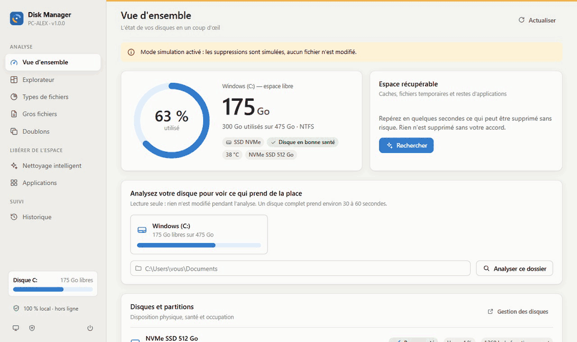

# Disk Manager

Gestionnaire de stockage **100 % local** pour Windows : visualiser ce qui occupe votre disque, comprendre où
part l'espace et le libérer en toute sécurité.



*Démo en mode simulation (`--dry-run`) sur un dossier de faux fichiers : rien n'est supprimé. Les informations de disque, d'applications et de nettoyage affichées sont fictives.*

## Lancer l'application

- Double-cliquez sur **`Disk Manager.cmd`** : une fenêtre d'application s'ouvre (Edge en mode application,
  avec un profil isolé et sans trafic réseau en arrière-plan).
- Pour créer un raccourci sur le Bureau et dans le menu Démarrer :
  ```
  python run.py --install-shortcut
  ```
- Mode simulation (aucun fichier n'est jamais supprimé, tout le reste fonctionne) :
  ```
  "Disk Manager.cmd" --dry-run
  ```

Prérequis : Python 3.10+ (installé depuis python.org). Aucune dépendance à installer.

## Fonctionnalités

| Écran | Ce qu'il fait |
|---|---|
| **Vue d'ensemble** | Espace libre, santé du SSD, plan des partitions, répartition du disque, espace récupérable, conseils |
| **Explorateur** | Carte proportionnelle (treemap) ou diagramme en soleil, navigation par dossier, liste triable, mise à la corbeille |
| **Types de fichiers** | Répartition par catégorie et par extension, plus gros fichiers d'un type, ancienneté des fichiers |
| **Gros fichiers** | Les plus gros fichiers du disque, filtrables par type, ancienneté et nom |
| **Doublons** | Fichiers identiques (comparaison par empreinte du contenu), sélection automatique en gardant un exemplaire |
| **Nettoyage intelligent** | Caches et fichiers temporaires (système, navigateurs, applications, outils de développement), anciennes versions d'applications, vieux installeurs : classés par niveau de risque |
| **Applications** | Programmes installés triés par taille, accès direct à l'outil de désinstallation de Windows |
| **Historique** | Évolution de l'espace utilisé, ce qui a grossi entre deux analyses, journal de toutes les suppressions |

Une analyse complète de C: prend environ 30 à 60 secondes ; elle est enregistrée et rouverte instantanément au
lancement suivant.

## Sécurité et confidentialité

- **Aucun appel réseau** : le serveur écoute uniquement sur `127.0.0.1`, l'interface ne charge aucune ressource
  externe (politique CSP stricte), aucune dépendance tierce (bibliothèque standard Python uniquement).
- **Accès protégé** : jeton aléatoire par lancement, vérification de l'hôte et de l'origine (protège contre les
  sites web malveillants qui tenteraient de piloter l'application).
- **Suppressions encadrées** (`dm/safety.py`, seul module autorisé à supprimer) :
  - vos fichiers (gros fichiers, doublons, explorateur) vont **à la corbeille** et sont restaurables ;
  - la suppression définitive est réservée aux caches et fichiers temporaires régénérables : seuls sont
    acceptés `%TEMP%`, quelques caches système précis et les dossiers qui sont des caches par nature
    (liste blanche de noms : `Cache`, `Code Cache`, `GPUCache`, `cache2`, caches npm / pip / Gradle / Cargo…).
    Le reste d'AppData et du profil est refusé : applications installées (`AppData\Local\Programs`), profils
    de navigateur (mots de passe, cookies), réglages, `~\.cargo\bin`… Jamais dans vos dossiers personnels ;
  - emplacements système refusés (Windows, Program Files, ProgramData, fichiers système, clés `.ssh`…), ainsi
    que tout dossier qui en contient ;
  - racines de profil de **tous** les comptes protégées : sous-dossiers de `C:\Users` et profils déclarés dans
    le registre (`ProfileList`, y compris ceux déplacés sur un autre disque). La liste est relue pendant que
    l'application tourne : un compte créé après le lancement est aussi protégé ;
  - jonctions et liens symboliques jamais suivis, noms courts 8.3 et chemins ambigus refusés ;
  - chaque suppression passe par un *handle* ouvert sans suivre les liens et dont l'emplacement réel est
    re-vérifié juste avant d'agir : remplacer un dossier par une jonction pendant un nettoyage ne permet pas de
    rediriger la suppression ;
  - fichiers en cours d'utilisation ignorés, fichiers OneDrive « en ligne » jamais lus ni supprimés ;
  - confirmation systématique et journal de chaque opération (`data/journal.jsonl`).
- Les fichiers système volumineux (hibernation, fichier d'échange, disques WSL, WinSxS, points de restauration)
  ne sont **jamais** supprimés : l'application explique comment les réduire avec les outils de Windows.

### Mode administrateur

Le bouton « Relancer en administrateur » sert uniquement à nettoyer les caches système (Windows Update,
fichiers temporaires de Windows…). Dans ce mode, l'application exécute le code de ce dossier avec des droits
élevés : ne l'utilisez que si ce dossier, et celui de Python, ne sont modifiables que par vous (ou installez
l'application et Python dans un emplacement protégé comme `C:\Program Files`). Un programme malveillant déjà
actif sous votre compte pourrait sinon modifier ce code avant que vous ne passiez en administrateur : les
protections ci-dessous ferment les autres portes, pas celle-là. Le jeton de session n'est jamais écrit sur disque en mode
administrateur, ni placé sur la ligne de commande de la fenêtre (lisible par tous les programmes de la
session) : la fenêtre reçoit à la place un code à usage unique, valable quelques secondes, que la page échange
contre le jeton puis garde uniquement en mémoire. Si un autre programme utilise ce code avant la fenêtre, le
jeton est aussitôt renouvelé : la session volée ne sert à rien, et la fenêtre affiche « Session expirée »
(relancez alors l'application). Pour la même raison, recharger la page (F5) en mode administrateur ferme la
session.

En administrateur, l'application ne lit et n'écrit rien qu'un programme non administrateur aurait pu préparer :

- Elle n'utilise pas `data/` (modifiable par tous les programmes de la session : un lien posé à la place du
  journal ou de `app.log` ferait écrire, ou renommer lors de la rotation du journal technique, n'importe quel
  fichier avec les droits administrateur). Ses analyses enregistrées, son historique, son journal, son journal
  technique `app.log` et son profil de navigateur sont rangés dans `C:\ProgramData\Disk Manager`. Ce dossier
  est créé au premier lancement en administrateur avec des droits réservés aux Administrateurs et à SYSTEM,
  puis vérifié avant chaque écriture : s'il appartient à quelqu'un d'autre, donne des droits à d'autres comptes
  ou est remplacé par un lien, l'application refuse de démarrer et affiche un message. Supprimez alors ce
  dossier et relancez. Conséquences : le mode administrateur repart sans les analyses du mode normal (il faut
  relancer une analyse) et tient son propre historique et son propre journal. Le dossier reste après
  désinstallation : supprimez-le à la main.
- Les emplacements système (`C:\Windows`, `Program Files`, `ProgramData`, votre profil, `AppData`, dossier
  temporaire) ne sont pas lus dans les variables d'environnement : un processus administrateur hérite de
  celles de l'utilisateur, que n'importe quel programme peut modifier (`HKCU\Environment`). Ils viennent de
  Windows lui-même (dossier Windows, registre machine, compte du processus) ; `AppData` et le dossier
  temporaire sont leurs emplacements par défaut dans le profil. Les règles de nettoyage et les zones protégées
  reposent sur ces emplacements.
- PowerShell (informations disques) et le navigateur sont lancés avec un environnement réduit à ces valeurs
  sûres : par exemple, une variable `PSModulePath` posée par un autre programme ferait sinon charger son propre
  module « Storage » par le PowerShell administrateur. Python est relancé avec `-E -s -B` (variables `PYTHON*`
  et paquets Python de l'utilisateur ignorés, aucun fichier `.pyc` écrit).
- Le navigateur de la fenêtre est pris uniquement dans `Program Files` (Edge, Chrome ou Brave), jamais dans une installation
  par utilisateur ; sans navigateur de ce type, le mode administrateur ne s'ouvre pas (pas de repli sur le
  navigateur par défaut, qui tournerait en administrateur sur le profil ordinaire).
- Un lancement en administrateur ne rejoint jamais une instance déjà ouverte : `data/instance.json` est
  modifiable sans droits, son port et son jeton pourraient diriger la fenêtre vers un autre programme. Une
  nouvelle instance démarre toujours.

## Données locales

Tout est rangé dans `data/` (ignoré par git) : analyses enregistrées, historique, journal, profil isolé de la
fenêtre, journal technique `app.log`. Supprimer ce dossier remet l'application à zéro. En mode administrateur,
les mêmes fichiers sont dans `C:\ProgramData\Disk Manager` (voir « Mode administrateur »).

## Développement

```
python run.py --no-window --dry-run     # serveur seul, affiche l'URL (avec son jeton)
python run.py --debug                   # journalise chaque requête dans data/app.log
python -m unittest discover -s tests    # tests
```

- `dm/` : backend (scanner parallèle, règles de nettoyage, sécurité, API) ; `web/` : interface (modules ES,
  sans build) ; `docs/API.md` : référence de l'API ; `docs/CLEANERS_SPEC.md` : règles de nettoyage.
- `web/dev/charts.html` : démo des composants graphiques.
